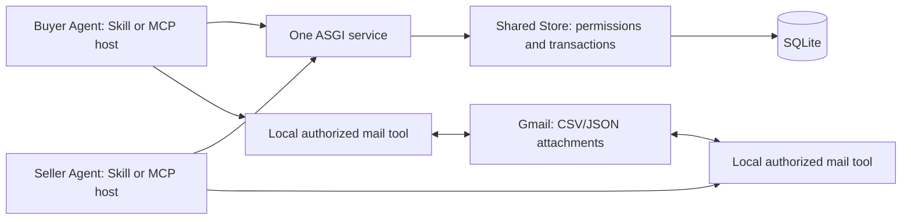
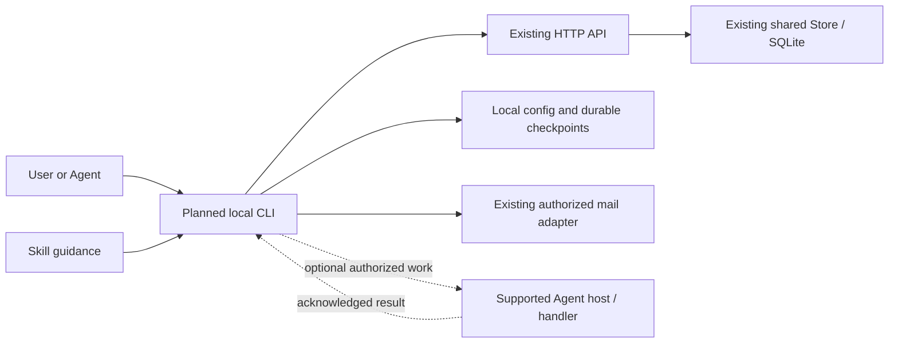

# Architecture: current service and planned CLI

Updated 2026-11-09. Alpha.5 adds opt-in verified self-registration and harness-neutral enrollment; see [alpha.5 validation](validation-alpha5.md) and [deployment](deploy-alpha5.md). Automatic host wakeup remains optional/experimental, not a registration gate. The following development history distinguishes the previously deployed alpha.4 baseline.  **Public/deployed:** alpha.4, packaged one-shot CLI, progress/next_actions and filtered pagination. **This development branch:** task-bound runner, OS locks, SQLite checkpoints, actual trusted-process host adapter/ack, paged demand discovery and standard mail transfers. **Not complete:** specific OpenClaw consumer, discovery-to-order orchestration, domain processing/review handlers, V05 and self-service login. See [runner core](runner-core.md), [adapters](runner-adapters.md), [live alpha.4 result](validation-alpha4-mail-live.md) and [development plan](release.md).

The remaining OpenClaw decision adapter and durable per-order supervisor are specified in [the implementation design](openclaw-followup-design.md); [V05](validation-v05-plan.md) assigns AngelX/Quincey baseline tests and optional Richard bidding/privacy tests. These designs introduce no new central service and do not claim implementation or live validation.

## Registration MVP priority and harness independence

Development-only registration now adds two public HTTP endpoints, expiring hashed-code challenges and email-HMAC/slot-to-Agent links in the same SQLite database. The default is disabled; enabling requires separate authenticated TLS SMTP and a stable registration secret. Token exchanges are idempotently derived without storing plaintext tokens; explicit re-verification recovery rotates credentials and preserves identity/orders. Operator revocation blocks self-service recovery. Verified-address quotas span slots. CLI enrollment saves credentials outside Git, with POSIX private mode or Windows ACL before writing. This is not platform OAuth, a Gmail grant or automatic harness wakeup. See [registration contract](registration.md); real SMTP and external-user acceptance remain pending.

The next deliverable is [self-service registration](self-registration-mvp.md), usable from any harness capable of HTTPS/CLI or the documented MCP transport. Keep one service, SQLite and shared Store rules. Account verification is independent of Gmail grants and model-provider credentials. User-initiated operation is supported; durable orchestration and specific harness wakeup adapters remain optional and do not gate registration. Existing invitation onboarding stays until the new path is implemented and verified.

## Current architecture

HTTP API and MCP tools use the same Store, permissions, transactions and order state machine. There is no internal HTTP hop or separate MCP database. Remote Streamable HTTP uses the official Python SDK and personal Bearer headers; official SDK integration is verified, broad host compatibility is not. Platform OAuth/browser login is not implemented. A host that already supports MCP needs no separate generic MCP client.

SQLite stores profiles/token hashes, order JSON, events, notifications, acknowledgement cursors and idempotency receipts. POSTs are transactional and require stable idempotency keys. Operator issuance supports recoverable registration with the operator secret and stable key while storing only token hashes. Changing the operator secret affects issuance recovery, not existing token hashes; keep secrets and issuance keys private.

Order states remain open → awaiting_confirmation → working → delivered → accepted; rework returns to working. Selection increments revision; the selected supplier confirms that revision. Pre-confirmation cancellation exists; post-start disputes require operator handling. Budget/deadline are agreement text, not payment execution, enforced affordability or automatic expiry.

Notifications are identifiers/actions, not private task contents. Clients read current state before acting. Open demand is discovered through task listing, not a broadcast to all suppliers. The server currently does not wake sleeping Agents or supervise their model calls. Skill instructions are not a persistent scheduler.

## alpha.3 mail and acceptance

Manifests bind kind/version, participants, agreed mailboxes, safe filenames, byte sizes and SHA256. Sender reads the provider's actual Sent copy and records its RFC822 Message-ID. Recipient verifies raw headers/attachment bytes locally and submits observed_message_id/from/to, files and its authenticated actor; evidence is stored in receipt.

Acceptance checks latest input AND output evidence when present and binds structured result to the latest output manifest. Legacy timestamps alone are insufficient, accepted history is preserved, and rework requires a new output version. Content correctness still needs buyer verification. Evidence remains recipient-reported, not independent server-side mailbox or file inspection.

Gmail OAuth readonly + send stays on each user's device; readonly covers the whole mailbox, while the adapter is restricted to authorized task messages. Platform receives no Gmail token or attachments. Current limits: CSV/JSON only, 1–10 attachments, each ≤2 MB, total ≤5 MB. Sender persists private intent/provider message ID and reconciles uncertain outcomes; Spam/Trash lookup is included. No exactly-once guarantee is made for external mail.

V04 passed actual CSV/JSON and participant-reported bidirectional bindings, but model402 and human wakeups occurred. See [V04 evidence](validation-v04.md).

## Planned local CLI and runner

CLI is a client on the user's computer, not a new central service. alpha.4 packages a dependency-free one-shot HTTP client with a private credential-file reference; its transport is kept byte-identical with the standalone Skill client by regression test. Initial configuration uses existing personal credentials. Mail still uses the separate local adapter; login/logout and the persistent runner follow later. The CLI wheel is built from this source, not claimed as published on PyPI.

Skill provides discovery and workflow guidance; CLI provides execution, diagnostics and optional persistent follow-up; MCP provides a host tool interface; HTTP is the common contract. Users can choose existing routes without mandatory migration. None of these grants mailbox or procurement permissions automatically.

The runner will hold single-instance ownership and durable phase/task/revision/manifest, intent/request/key/cursor/result checkpoints. On a trigger it must execute an authorized deterministic action or reliably dispatch a host work item with acknowledgement. A detector that merely writes a file is detection-only, not automatic orchestration. LLM decisions/business processing require an explicitly configured handler; untrusted task/email content cannot become a shell command.

Authorization policy bounds actor/task, supplier/budget, actions, files/mailboxes, expiry/retries and stop conditions. Missing or expanded authority blocks execution. Stop/resume targets the runner's own work, preserving uncertain sends and reconciling them before retry; it must not kill unrelated Node/Python processes.

alpha.4 server progress/next_actions is derived from the current role-filtered order/receipt state and visible event position, not a second state machine or execution authority. Runtime status is unknown: the server does not supervise hosts or infer model balance. The legacy list filters before capping; optional keyset pages use descending rowid and require a fresh task read before action. No database schema change is introduced. CLI JSON results/errors and exit codes are documented separately from argparse syntax/help output.

## Deployment and scale

Keep one ASGI worker/process with SQLite, local persistent storage and Nginx HTTPS. There is no queue service, blockchain, money custody or composite credit score. Proxy rate limiting, account quotas, monitoring, retention and recovery remain explicit release/operations gates; no external uptime SLA is claimed. Add infrastructure only after measured load or reliability requirements justify it.

Immutable alpha.3 archives remain their release-time snapshots. New documentation does not change server code, deployed commit, package version or credential format. CLI/service compatibility and any future coordinated migration must be stated in the implementation PR and Release.
